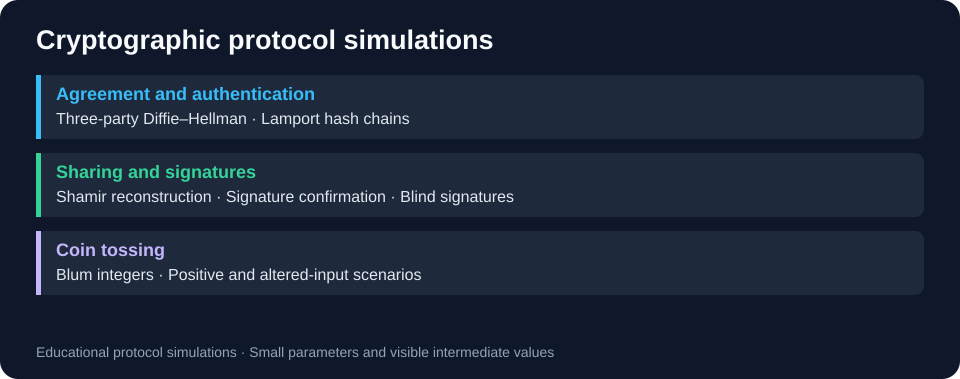

# Cryptographic protocol simulations

[← Portfolio](../../README.md)

Six academic simulations expose intermediate values and protocol steps for learning.



## Technologies and contents

Python 3, SageMath, SHA3-512, modular arithmetic, finite fields and polynomial interpolation.

| File in src/ | Topic | Limitations |
|---|---|---|
| diffie_hellman.sage | Three-party shared-key calculation | Small parameters; printed private exponents |
| lamport.py | Multiuser hash-chain authentication | Predictable seeds; chain exhaustion unhandled |
| shamir.sage | Polynomial shares/Lagrange reconstruction | Small field; leading coefficient can be zero |
| signature_simulation.sage | Signature confirmation/altered-input cases | Local private state; not independent network verification |
| blum_coin.sage | Blum coin tossing/invalid cases | Small parameters; not independently audited |
| blind_signature.sage | Blinding/signing/tampering cases | Teaching parameters and exposed intermediate secrets |

## Run

```sh
python3 src/lamport.py
sage src/diffie_hellman.sage
sage src/shamir.sage
```

Use an installed SageMath environment for every .sage file. Original .txt snippets use Sage syntax such as ^ and P.<x>; .sage invokes the [Sage preparser](https://doc.sagemath.org/html/en/reference/misc/sage/misc/persist.html). The six coursework snippets are also available in coursework/archive/2-Rok/PK/.

## Results and limits

The [Lamport example](results/lamport-check.md) completes three successful verifications with the default settings. Execution logs for the SageMath examples are not included.

The signature simulation returns success only inside an if ok and verbose branch, so verbose=False can report failure even when comparisons succeed. These are educational simulations with small parameters and visible intermediate secrets, not a production cryptography library.
