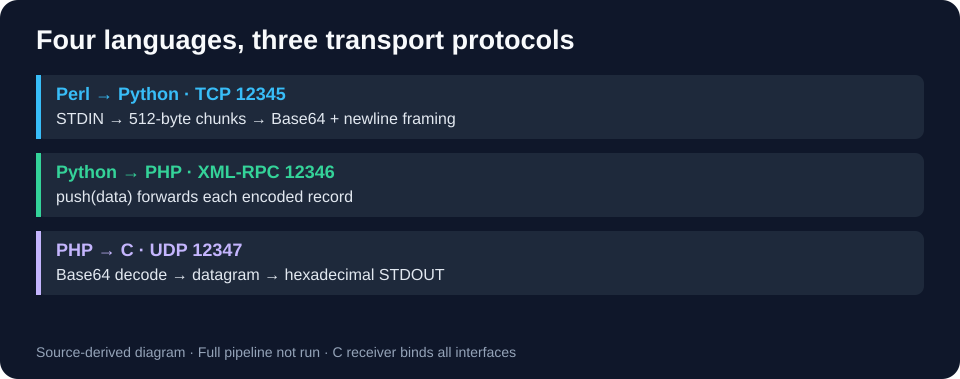

# Four-process distributed protocol pipeline

[← Portfolio](../../README.md)

An academic IPC exercise passes input through four languages and three protocols, then writes its hexadecimal representation.



## Technologies and source layout

| Stage | Source in src/ | Behavior |
|---|---|---|
| Perl | proces1_perl_tcp.pl | STDIN → 512-byte chunks → Base64/newline records over TCP |
| Python | proces2_python_xmlrpc.py | Accept TCP records → XML-RPC push(data) |
| PHP | proces3_php_udp.php | XML-RPC → Base64 decode → UDP bytes |
| C | proces4_c_udp_hex.c | Receive UDP → hexadecimal STDOUT |

The src/ directory contains all four processes and a Makefile. The coursework archive also contains PPZ_Projekt.zip.

## Run in an isolated Linux lab

Requires Perl with MIME::Base64, Python 3, GCC/make and PHP with both sockets and XML-RPC functions. Check PHP first:

```sh
php -r 'exit(extension_loaded("sockets") && function_exists("xmlrpc_server_create") ? 0 : 1);'
```

If it fails, the original PHP stage cannot run in that environment. See the [PHP XML-RPC installation manual](https://www.php.net/manual/en/xmlrpc.installation.php). No compatibility repair is implied.

From src/, build with make, then run these long-lived receivers in **three separate terminals**, in this order:

```sh
make
./proces4
```

```sh
php -S 127.0.0.1:12346 proces3_php_udp.php
```

```sh
python3 proces2_python_xmlrpc.py
```

In a fourth terminal, send:

```sh
printf 'SOC lab\n' | perl proces1_perl_tcp.pl
```

Expected C output: 53 4f 43 20 6c 61 62 0a. This is the expected transformation, not a captured full-pipeline result. Stop receivers with Ctrl+C.

## Results and limitations

The full pipeline requires the Linux environment and dependencies listed above. An end-to-end execution result is not included.

TCP/RPC use loopback, but the C receiver binds INADDR_ANY. Restrict the lab network/firewall. UDP has no acknowledgement or retransmission. MD5 is printed as a diagnostic, not used for authentication. There is no TLS, peer authentication or verified message integrity. This is an IPC exercise, not a secure production service.
