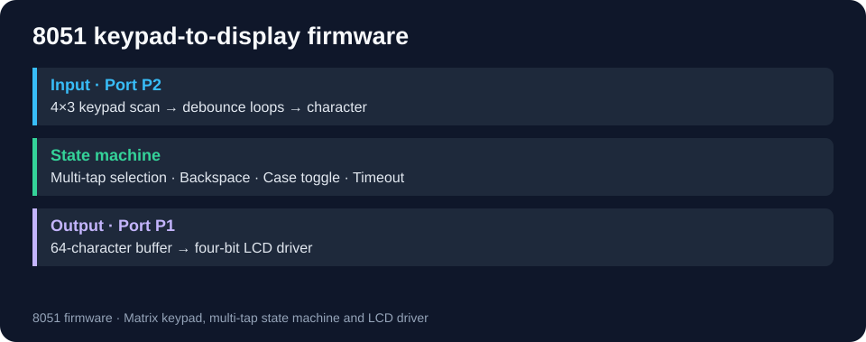

# 8051 multi-tap keypad and LCD

[← Portfolio](../../README.md)

Embedded C coursework implements text entry from a 4×3 matrix keypad: multi-tap selection, case switching, backspace and a 64-character buffer.

## Technologies and files

8051 / REGX52.H, C, Proteus, GPIO and a four-bit LCD interface. src/main.c contains input/state logic; src/lcd.c drives the display; src/PROJ2.pdsprj holds the circuit project. Files are unchanged copies.

## Build and inspect

Open the Proteus project and check its selected MCU and clock. Build both C files with an 8051 compiler providing REGX52.H, then assign the resulting firmware to the simulator. Exact toolchain version, a full compiler project and a prebuilt HEX are not included, so this is not a verified one-click build.

Keypad: P2. LCD control/data: P1. Check the circuit against those assignments before simulation.

## Behavior visible in source

- Numeric presses cycle a key's character set.
- 0 inserts space; * deletes; # toggles case.
- Timeout commits the current character; its counter uses delay-loop iterations, not calibrated milliseconds.
- Filling the 64-character buffer clears it and restarts entry.

## Results and limits

The source demonstrates GPIO handling, a state machine and a display driver. No new hardware/simulator test was run. Debounce timing and display geometry need verification against the actual clock/circuit. No security or secure-input capability is claimed.
