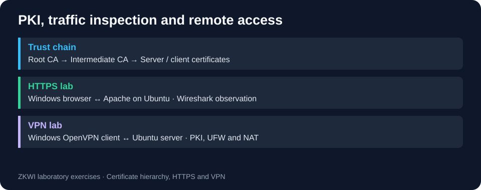

# PKI, HTTPS traffic analysis and OpenVPN

[← Portfolio](../../README.md)

Build and inspect a laboratory trust chain, compare HTTP and HTTPS traffic, and document certificate-based VPN access. This supports network troubleshooting and SOC traffic interpretation.

## Technologies

OpenSSL, X.509, Apache, Wireshark, Ubuntu, Windows, OpenVPN, Easy-RSA and UFW.

## Work documented in the original reports

- Lab 1: root/intermediate CA, certificate issuance, certificate inspection and chain verification.
- Lab 2: Apache setup, HTTP packet inspection, a server certificate signed by the intermediate CA, HTTPS configuration and a browser trust-store exercise.
- Lab 4: Ubuntu VPN server with two interfaces, client/server certificates, tls-crypt, UFW/NAT and a Windows OpenVPN client.

## Review and reproduction

Read the [PKI report](../../coursework/archive/main/ZKWI/Godlevskyi_lab1.pdf), [HTTPS report](../../coursework/archive/main/ZKWI/Godlevskyi_lab2.pdf) and [VPN report](../../coursework/archive/main/ZKWI/Godlevskyi_lab4.pdf). Retained screenshots are historical lab evidence, not new captures or redacted screenshots.

To reproduce, use separate lab VMs and fresh keys/certificates. Assign your own private addresses and local example hostname. Follow the reported sequence: create the CA hierarchy, issue a server certificate, configure Apache, capture HTTP and HTTPS, then verify the certificate chain. Run the VPN exercise separately with new credentials. No private key, .ovpn profile, PCAP or tested installation script is provided.

## Results and limits

The reports describe HTTP/TLS inspection, CA-chain validation and a connected VPN client. Results are documented in the linked laboratory reports. Exact packets, cipher negotiation and current connectivity cannot be independently revalidated without the original capture/environment.

The original HTTPS report overinterprets TLS 1.3 ChangeCipherSpec: it can be a compatibility record and does not alone prove key establishment. Handshake messages after ServerHello are encrypted; a certificate decoded from a TLS 1.3 capture requires the appropriate decryption context. Protocol reference: [RFC 8446 section 2](https://www.rfc-editor.org/rfc/rfc8446.html#section-2) and [appendix D.4](https://www.rfc-editor.org/rfc/rfc8446.html#appendix-D.4), relevant to this historical lab.

No Cisco Packet Tracer source project was located in the reviewed snapshots.
