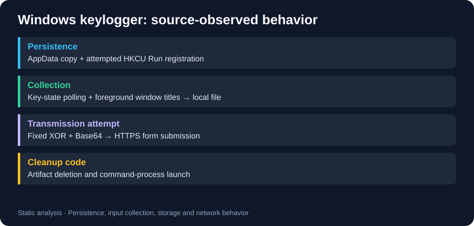

# Static analysis of an academic Windows keylogger

[← Portfolio](../../README.md)

A defensive case study of the ONI keylogger. Despite hardware-diagnostics branding, its source records keystrokes and window context, attempts persistence and sends data outward.

## Technologies and scope

C++, WinAPI, registry/file I/O and WinINet. This case study covers the source code and its Windows artifacts using static analysis.

Contents: a [static source reference](reference/main.cpp.disabled.txt), a behavior diagram and [analysis notes](ANALYSIS.md). The reference has a text extension and placeholder collection identifiers.

## Source observations

| Area | Evidence | Investigation relevance |
|---|---|---|
| Persistence | InstallIfNeeded copies into AppData and attempts an HKCU Run value. | Correlate registry writes and executable creation. |
| Input | PollingLoggerEngine polls key states and foreground window titles. | Ordinary Windows logs do not expose every API call. |
| Storage | Hardware.dat holds captured text. | Preserve before cleanup. |
| Encoding | EncryptXORBase64 applies a fixed XOR byte and Base64. | Reversible obfuscation, not robust encryption. |
| Network | NetworkExfiltrationWorker attempts HTTPS form submission after a character threshold. | Correlate process/network/file evidence; TLS metadata does not reveal the POST body. |
| Deletion | SelfDestruct removes artifacts and starts a command process. | Do not invoke during evidence collection. |

## Defensive review workflow

Read the source reference and [analysis notes](ANALYSIS.md). For a suspected real event, preserve evidence, isolate through the organization's response process, establish scope and assess credential exposure. 

## Results and limits

The case study maps source behavior to host artifacts and investigation questions. Runtime behavior, binary/source equivalence and detection rules have not been validated.
