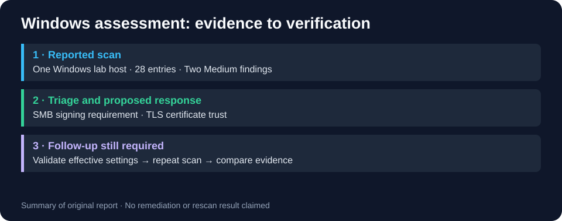

# Windows vulnerability assessment with Nessus

[← Portfolio](../../README.md)

An academic assessment of a Windows 11 lab host: interpret findings, prioritize risk, and propose remediation and verification.

## Technologies and scope

Nessus Advanced Scan, Windows 11, SMB signing and TLS trust. Scope: one lab host, referred to here as WIN-LAB-01.

## Reported findings

The report records 28 entries, including two Medium findings. The raw .nessus export is absent, so counts and severity are attributed to the report.

| Finding | Risk to investigate | Proposed response | Follow-up |
|---|---|---|---|
| SMB Signing not required | Integrity/relay exposure depends on roles, authentication and network conditions. | Check compatibility, require signing where appropriate and restrict SMB reachability. | Check effective policy and negotiated signing; rescan. |
| SSL Certificate Cannot Be Trusted | Scanner cannot establish trust; inspect the precise cause. | Check chain, validity, intended hostname and CA trust store. | Verify from the intended client/scanner; rescan. |

These are recommendations, not completed remediations. Predicted residual risk was not measured by a post-change scan.

## Report and methodology

Read the [original assessment](../../coursework/archive/3-Rok/PBI/Godlevskyi_Andrii_WCY23KC1S1-Zadanie_3.docx). Reproduction requires an owned/authorized lab host: record scanner version and policy, export the scan, validate the findings manually, document changes and repeat the same scope. Do not assume historical findings apply to a different host or Windows configuration.

## Results and limitations

The assessment provides finding triage, risk analysis and a remediation plan. The repository does not include a raw scan export or a post-remediation scan.
